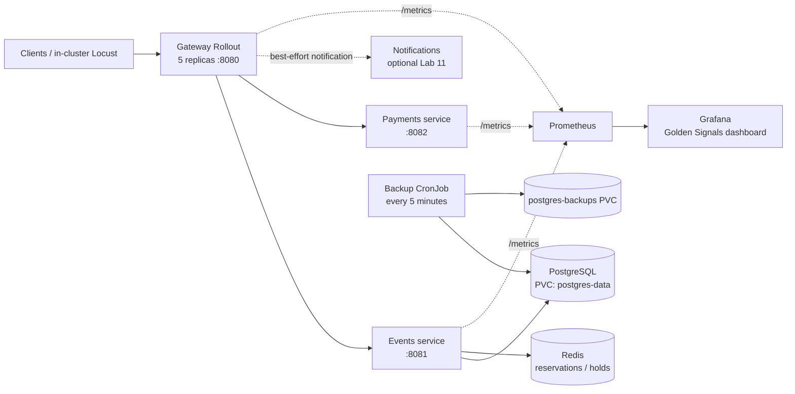

# QuickTicket SRE Handbook

*A concise operations guide for the QuickTicket lab environment.*

## 1. Architecture



- **Gateway** is a stateless five-replica Argo Rollout. It routes reads/reservations to Events and charges to Payments.
- **Events** stores inventory and orders in PostgreSQL; Redis holds temporary reservations. Payments is a fault-injectable mock.
- Postgres uses the `postgres-data` PVC. The five-minute CronJob writes PostgreSQL 17 custom dumps to `postgres-backups`, mounted at `/backups` by the inspector pod.
- Run capacity tests from inside Kubernetes. A Service port-forward can pin traffic to one backend.

## 2. Deploy and roll back

1. Branch, validate, and open a PR. For app changes, the intended path is Git → CI image build/push → ArgoCD sync → Kubernetes/Argo Rollouts health check.
2. Check ArgoCD with `kubectl get applications -n argocd` and `kubectl describe application quickticket -n argocd`. Sync if needed; `kubectl apply` alone does not prove GitOps converged.
3. Verify with `kubectl get pods,svc -n default` and `kubectl argo rollouts get rollout gateway`. Confirm replicas are Ready and inspect AnalysisRuns before promotion.
4. Roll back by reverting and pushing the bad Git commit, then sync and verify Healthy status plus a smoke check. Avoid persistent manual edits to Git-managed resources.

## 3. Monitoring and first response

Use **QuickTicket — Golden Signals** when Grafana is available. Request rate, error rate, and scrape health are provisioned; latency and DB-pool panels remain instructional placeholders, so use these PromQL queries in Prometheus:

| Signal | PromQL / check | Use |
| --- | --- | --- |
| Request rate | `sum by (path) (rate(gateway_requests_total[1m]))` | Traffic and route mix |
| 5xx rate | `sum(rate(gateway_requests_total{status=~"5.."}[5m])) / sum(rate(gateway_requests_total[5m])) * 100` | User-visible server error percentage |
| p99 latency | `histogram_quantile(0.99, sum by (le) (rate(gateway_request_duration_seconds_bucket[5m])))` | Tail latency (seconds) |
| Scrape health | `up` | `0` means a target is not being scraped successfully |
| DB pool | `events_db_pool_size` | Connection saturation; compare with configured pool size |

**Triage:** run `kubectl get pods,svc,endpoints -n default`, then `kubectl describe pod <pod>` and `kubectl logs <pod> --since=10m`. Check gateway `/health`. Reservation 409s indicate inventory conflict, not server errors. Inspect Events for probe failures, sandbox/image-pull failures, or PVC issues.

## 4. Incident runbook: elevated gateway errors / database unavailable

1. **Scope:** record the start time, check Prometheus 5xx/p99, and inspect pods, endpoints, and Events. Never delete a PVC as a troubleshooting shortcut.
2. **Localize:** check gateway `/health`; inspect Events logs for `UndefinedTable`, pool, or connection errors; verify Postgres/PVC and Redis health.
3. **Mitigate:** abort a bad canary or revert through GitOps. Reset unintended fault-injection variables. Restart Events only if its DB pool is stale after recovery.
4. **Recover:** verify dependencies and gateway endpoints are Ready, `/events` returns 200, expected rows exist, and 5xx has returned to baseline. Record timeline, impact, cause, and follow-ups; escalate to the instructor/TA if recovery stalls.

## 5. PostgreSQL backup and restore

**Locate and verify a backup.** Dumps are on the backup PVC, not automatically on the host filesystem:

```sh
kubectl exec deployment/backup-inspector -- ls -lht /backups
# Copy a selected dump to the local machine; replace POD and DUMP with actual values.
POD=$(kubectl get pod -l app=backup-inspector -o jsonpath='{.items[0].metadata.name}')
DUMP=quickticket_<UTC-timestamp>.dump
kubectl cp "$POD:/backups/$DUMP" "/tmp/$DUMP"
```

If the PVC or inspector is absent, first apply `labs/lab9/backup-storage.yaml` and wait for the inspector to be Ready. The CronJob must also be installed and have completed successfully.

Use a PostgreSQL 17 `pg_restore` for dumps produced by PostgreSQL 17; an older host client may reject the archive header. Inspect contents with `pg_restore --list`. Before a destructive operation, check `events` and `orders` counts and take/verify a fresh dump.

For a disposable **empty** database/pod, copy in the verified archive and restore with the matching PostgreSQL client:

```sh
POSTGRES_POD=$(kubectl get pod -l app=postgres -o jsonpath='{.items[0].metadata.name}')
kubectl cp "/tmp/$DUMP" "$POSTGRES_POD:/tmp/$DUMP"
kubectl exec "$POSTGRES_POD" -- pg_restore --clean --if-exists --no-owner \
  -U quickticket -d quickticket "/tmp/$DUMP"
```

Verify both tables/counts, restart Events if its pool is stale, and test `/events`. Normal PVC-backed pod restarts should not need `pg_restore`. The CronJob runs every five minutes, writes `-Fc` dumps, and keeps five; test restore as well as dump creation.
